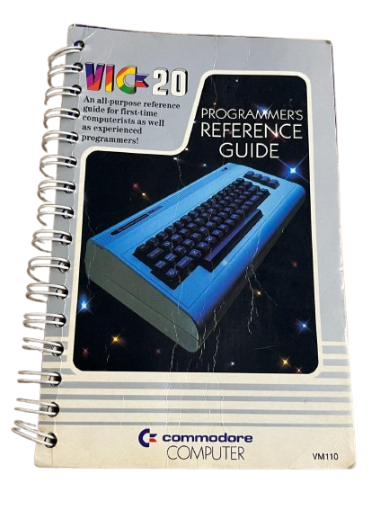

Rust systems engineer building native, memory-safe infrastructure through forensic differential parity testing.

My first computer was a Commodore VIC-20 and then an Olivetti M24.

Where it all started:

  
   
  <a href="https://en.wikipedia.org/wiki/VIC-20" target="_blank" rel="noopener noreferrer">Commodore VIC-20 on Wikipedia</a>

Protocol and systems expertise: Compilers, protocols, Unix tooling, performance and deterministic verification.
LLM-assisted. Engineer-directed. Oracle-verified.

Time synchronization: NTPsec-rs, OpenNTPD-rs and chrony-rs.

Compilers and toolchains: llvm-native, Autotools-rs and GnuCOBOL-rs

Performance and foundational infrastructure: ryg-rANS-rs, GMP-rs, ncurses-native and zic-rs(tzsuite-rs).

Available for Rust systems work.

  
   
  <a href="https://www.youtube.com/watch?v=tYzMYcUty6s" target="_blank">Watch: NEVER GIVE UP YOUR WAAAAAAAAAAAAY</a>

